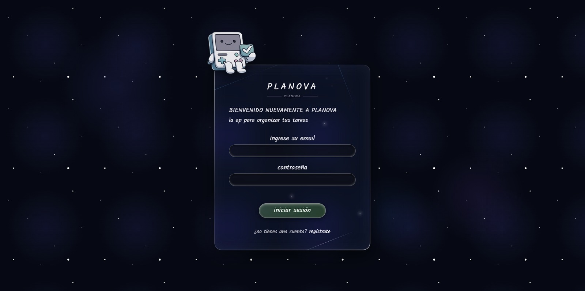
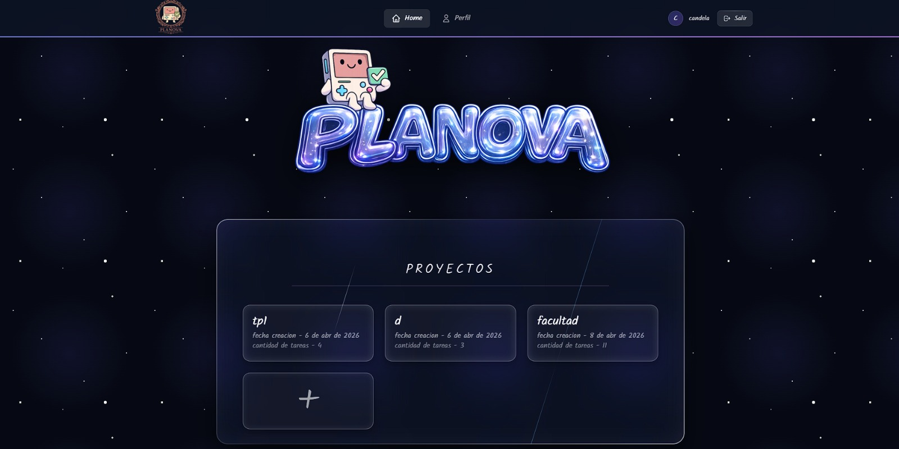
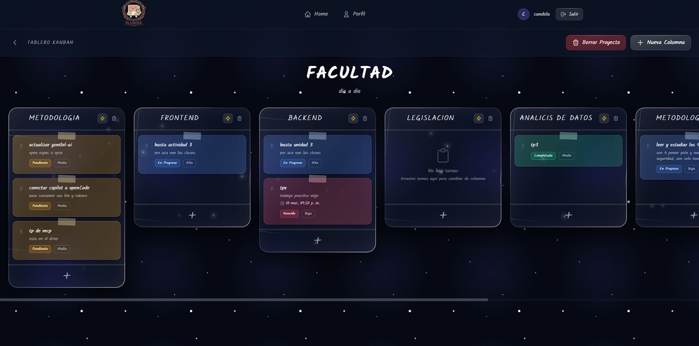
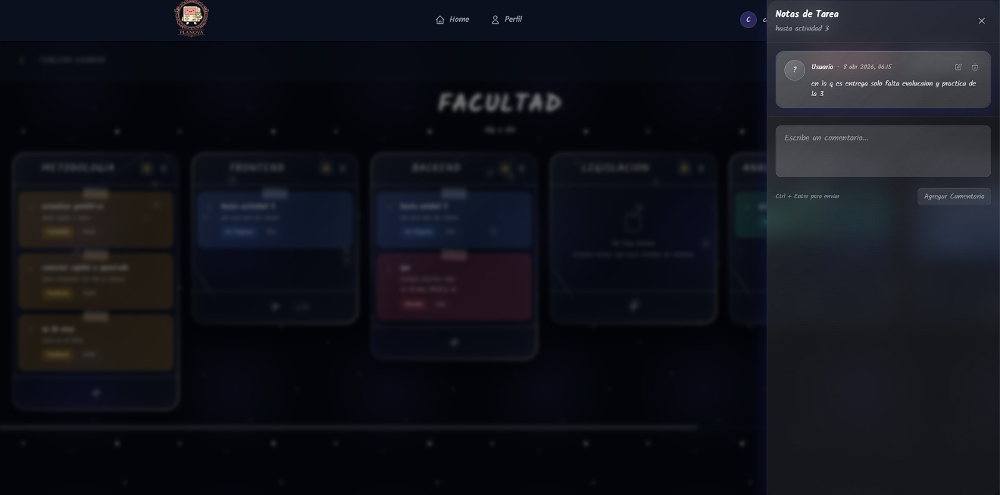

<p align="center">
  
</p>

<h1 align="center">PLANʘVA</h1>

<p align="center">
  <strong>Organiza tu universo de tareas con estilo.</strong><br>
  Una plataforma Kanban moderna diseñada para fluir.
</p>

<p align="center">
  
  
  
  
  
</p>

---

## ✨ Características Principales

*   **Tablero Kanban Interactivo:** Arrastra y solta tareas entre columnas con una experiencia fluida gracias a `@dnd-kit`.
*   **Estética Glassmorphism:** Interfaz visual moderna con desenfoques, transparencias y gradientes premium.
*   **Seguridad de Hierro:** Autenticación vía JWT con validación de propiedad (Ownership) estricta en cada petición.
*   **Gestión de Tareas Inteligente:** Prioridades, fechas de vencimiento y auto-vencimiento automático.
*   **Totalmente Responsive:** Diseñado para verse bien en cualquier dispositivo.

<p align="center">
  
</p>

---

## 🚀 Guía de Inicio Rápido

Hay dos formas de ejecutar Planova. La **Opción A (Docker)** es la recomendada: no necesitás instalar Java, Node ni MySQL.

### 🐳 Opción A: con Docker (recomendada)

**Requisito único:** [Docker Desktop](https://www.docker.com/products/docker-desktop/) instalado.

1. **Cloná el repositorio:**
   ```bash
   git clone https://github.com/tu-usuario/planova.git
   cd planova
   ```
2. **Iniciá la aplicación:** hacé doble clic en `INICIAR.bat` (en Windows) o ejecutá:
   ```bash
   docker compose up -d --build
   ```
   > ⏳ La primera vez tarda unos minutos porque construye las imágenes y descarga dependencias. Las siguientes veces es mucho más rápido.
   > Si `INICIAR.bat` no encuentra el archivo `.env`, lo crea automáticamente a partir de `.env.example`.
   > Si usás `docker compose` a mano, primero copiá `.env.example` como `.env`.
3. **Abrí la aplicación** en `http://localhost:5173`.
4. **Detenela** con `DETENER.bat` o con:
   ```bash
   docker compose down
   ```
   Tus datos se conservan (volumen `planova-mysql-data`).

**Configuración:** editá el archivo `.env` de la raíz del proyecto para cambiar contraseñas (`DB_PASSWORD`, `JWT_SECRET`) o puertos (`FRONTEND_PORT`, `BACKEND_PORT`, `MYSQL_PORT`).

**Ver logs:**
```bash
docker compose logs -f backend
```

### 🛠 Opción B: instalación manual (desarrollo)

**Requisitos:** Java 17, Maven (o el `mvnw` incluido), MySQL 8 y Node.js 18+.

1. **Backend:** creá `Planova-BACKEND/.env` basándote en `Planova-BACKEND/.env.example`:
   ```env
   DB_URL=jdbc:mysql://localhost:3306/planova
   DB_USERNAME=tu_usuario
   DB_PASSWORD=tu_password
   JWT_SECRET=una_clave_secreta_muy_larga_y_segura
   ```
   El backend carga ese archivo automáticamente, así que alcanza con ejecutar desde `Planova-BACKEND/`:
   ```bash
   ./mvnw spring-boot:run
   ```
2. **Frontend:** desde `Planova-FRONTEND/`:
   ```bash
   npm install
   npm run dev
   ```
   La aplicación estará disponible en `http://localhost:5173`.

### 🩺 Problemas frecuentes

- **Puerto en uso:** cambiá `FRONTEND_PORT`, `BACKEND_PORT` o `MYSQL_PORT` en `.env` y volvé a iniciar.
- **Docker no está corriendo:** abrí Docker Desktop y esperá a que termine de arrancar (`INICIAR.bat` intenta abrirlo por vos).
- **`JAVA_HOME` inválido (modo manual):** apuntalo a una instalación de JDK 17 válida.

---

## 🛠 Arquitectura y Documentación

Para una inmersión profunda en el código, revisá nuestras guías técnicas:

- 🏗 **[Documentación del Backend](Planova-BACKEND/DOCUMENTACION_TECNICA.md)**: Seguridad, API y Lógica de Negocio.
- 🎨 **[Documentación del Frontend](Planova-FRONTEND/DOCS_TECNICA_FRONT.md)**: Arquitectura de componentes y React.
- 📖 **[Guía General del Producto](GENERAL_DOCS.md)**: Visión funcional y flujos.

---

## 📈 ¿Qué debemos mejorar? (Roadmap)

En cada etapa de este proyecto hemos identificado oportunidades para que **PLANOVA** crezca aún más:

### Backend
- **Swagger:** Integrar documentación técnica interactiva.
- **Audit Logs:** Registrar cada acción importante para mayor seguridad.
- **Refresh Tokens:** Mejorar la experiencia de usuario al renovar sesiones.

### Frontend
- **Tests Automatizados:** Incluir Vitest para asegurar que las nuevas features no rompan lo existente.
- **Filtros de Búsqueda:** Poder buscar tareas por nombre o filtrar por prioridad en tableros grandes.
- **Skeletons:** Mejorar los estados de carga con animaciones placeholder.

### General
- **Modo Colaborativo:** Permitir que varios usuarios trabajen en el mismo tablero.
- **Multi-idioma:** Soporte para inglés y otras lenguas.

---

## 📸 Capturas de Pantalla

¡Mirá cómo se ve la experiencia Planova!

<p align="center">
  <strong>Portal de Acceso (Glassmorphism UI)</strong><br>
  
</p>

<p align="center">
  <strong>Dashboard de Proyectos</strong><br>
  
</p>

<p align="center">
  <strong>Tablero Kanban Interactivo</strong><br>
  
</p>

<p align="center">
  <strong>Gestión de Notas y Comentarios</strong><br>
  
</p>

---

<p align="center">
  Hecho con ❤️ por el equipo de Planova.<br>
  <i>"Tu productividad, elevada al cuadrado."</i>
</p>

<p align="center">
  
</p>
